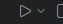
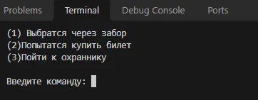
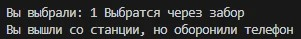
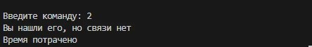

# Руководство пользователья 
# Пункт 1:
- Пользователь — любой посетитель Сайта, который просматривает его страницы, регистрируется в личном кабинете или пользуется предоставляемыми на нём услугами и инструментами.
- Программист — это специалист, который создаёт, тестирует и поддерживает компьютерные программы, сайты, мобильные приложения и другие цифровые сервисы с помощью языков программирования. 
# Запуск программы:
# Пункт 2:
- 2.1 В нашем проекте есть определенная программа который разработал программист а пользователь запускает и делает выводы.
- 2.2 Запуск начинается с помощью редактора VSC и пользователь принимает наш документ и соглашается с руководством пользователья
- 2.3 Пользователь в проекте вводит и после чего показывает определенные варианты для того чтобы проверить что проект в нормальном состоянии.

**----------------------------------------------------------------------------**

# Функции:
# Шаг 1:
- В редакторе можно будет запустить программу и нажать на кнопку треугольника:

# Шаг 2:
- В терминале будет отображаться выбор варианта:

# Шаг 3:
- И будет вам показывать результат выбора.

# Шаг 4:
Конечный результат попытаться выйти со станции:

