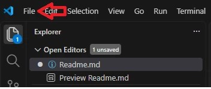
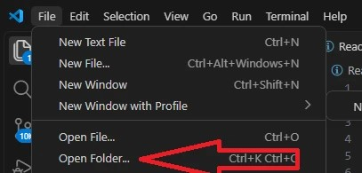

# Проект "Последняяя Электричка"
1. Человек позже вечером после работы идет к станции ожидая поезда.
2. Цель: Добраться до дома правильным путьем.

## Как запустить программу?
1. Вы должны создать папку и в неё создать файл
2. Далее зайти в редактор VSC
3. И нажимаете File      

4. Далее Open Folder

  5. Запускаете программу

  6. Нажимаете треугольную кнопку: 

## Начало и конец действий человека
### У человека будет несколько выборов:
1. Спросить у охранника
2. Выбраться через забор
3. Попытаться купить билет

## О чем идет речь о проекте?
1. Человек попал на незнакомую станцию
2. Решает как надо выбраться
3. Использует различные варианты выхода

